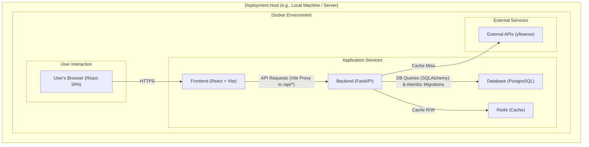

# System Architecture Document

This document outlines the high-level architecture for the Personal Portfolio Management System (PMS).

## 1. Architecture Diagram

The following diagram illustrates the components of the system and the flow of information.

## 2. Architectural Decisions

### 2.1. Architecture Pattern: Client-Server (SPA)

We will use a **decoupled Client-Server architecture**. The frontend will be a Single Page Application (SPA) that communicates with a backend via a RESTful API.

*   **Pros:** This pattern provides excellent separation of concerns, allows for independent development and scaling of the frontend and backend, and enables a modern, responsive user experience. It also allows the same API to be used by a future mobile application.

### 2.2. Technology Stack

*   **Backend:** **Python** with **FastAPI**. Chosen for its high performance, automatic data validation with Pydantic, and excellent ecosystem for data analysis and AI.
*   **Frontend:** **JavaScript** with **React**. Chosen for its component-based architecture, which is ideal for building complex UIs like our dashboard, and its vast ecosystem of libraries.
*   **Database:** **PostgreSQL**. Chosen for its reputation for reliability, data integrity (ACID compliance), and ability to handle complex queries, all of which are critical for a financial application.

### 2.4. Background Task & Job Scheduling Architecture

The backend integrates **APScheduler** (`AsyncIOScheduler`) directly into the FastAPI application lifespan.

*   **In-Process Execution:** Operates asynchronously inside the FastAPI event loop, removing the need for heavyweight external Celery workers or broker dependencies on resource-constrained devices (e.g. Raspberry Pi, Android Chaquopy, and Desktop SQLite).
*   **Concurrency & Idempotency:** Jobs use `coalesce=True`, `max_instances=1`, and in-memory execution guards to prevent overlapping task runs.
*   **Execution Audit Trail:** Lifecycle events (`EVENT_JOB_EXECUTED`, `EVENT_JOB_ERROR`, `EVENT_JOB_MISSED`) are captured via event listeners and logged into the `scheduled_job_logs` table.
*   **Extensibility:** Modular workers reside in `app/tasks/` (e.g. daily portfolio valuation snapshots, bond corporate action processing, market news scraping). Admin endpoints under `/api/v1/admin/scheduler` and UI in `SchedulerDashboard.tsx` provide live monitoring, pause/resume, and manual triggers.

### 2.4. Security & Sensitive Data Protection (`EncryptedString` Model)

To guarantee strict user data privacy on local single-user desktop deployments (PyInstaller) and mobile devices (Android SQLite), all sensitive PII and financial ledger fields are protected using field-level encryption:

*   **Custom SQLAlchemy Type Decorator:** `EncryptedString` (`backend/app/db/custom_types.py`) transparently encrypts data before database write and decrypts upon read using AES-256-GCM symmetric encryption keys managed by `KeyManager`.
*   **Key Persistence & Rotation:** Secret keys are generated and persisted locally in `secret.key` within the user's app data directory (`_get_app_dir()`), preventing unauthenticated decryption across application restarts.
*   **Encrypted Columns:** Applied to `IncomeSource.name`, `IncomeSource.payer_name`, `IncomeEntry.gross_amount`, `IncomeEntry.tds_amount`, `IncomeEntry.net_amount`, `IncomeEntry.notes`, `IncomeEntry.basic_amount`, `IncomeEntry.hra_amount`, `IncomeEntry.rent_paid`, `TaxDeduction.title`, `TaxDeduction.amount`, and `TaxDeduction.proof_notes`.

### 2.5. Tax Engine & Versioned Statutory Rules Registry

Tax analytics and regime estimations are driven by modular, decoupled services:

*   **Statutory Tax Rules Registry (`TaxRulesRegistry`):** `backend/app/core/tax_rules_registry.py` maintains year-over-year statutory rules for Financial Years 2021-22 through 2026-27 (tax slab brackets, standard deduction limits, Section 87A rebate ceilings, 4% Cess, and Section 80C/80D caps).
*   **Unrealized Tax Service (`UnrealizedTaxService`):** Computes lot-level unsold FIFO unrealized STCG/LTCG across equity, debt, foreign stocks, and mutual funds, pooling Section 112A equity LTCG exemption headroom (₹1,25,000 threshold/FY).
*   **Salary Exemption Service (`SalaryExemptionService`):** Enforces statutory Section 10(13A) HRA exemption rules with 100% mathematical parity against benchmark Excel tax calculators (`local/TaxCalc_2027.xlsx`).

### 2.6. Edge AI & Quantitative Concall Intelligence (Release v1.5.0)

ArthSaarthi performs privacy-preserving financial NLP and speech-to-text completely on-device without external LLM APIs:

*   **Audio Transcription (`whisper_engine.py`):** Uses `faster-whisper` (CTranslate2 INT8 quantized on CPU) with PyAV stream decoding and Indian financial phonetic normalization (`FINANCIAL_WHISPER_PROMPT` + post-ASR regex calibration).
*   **Financial Sentiment (`finbert_onnx.py`):** Runs `yiyanghkust/finbert-tone` INT8 ONNX via `onnxruntime` for sentence-level Positive/Negative/Neutral scoring.
*   **Quantitative Concall Analyzer (`concall_analyzer.py`):** Computes Prepared Remarks vs Q&A Tone Divergence, Loughran-McDonald Hedging & Uncertainty Index, 4-Aspect Sentiment Scorecards (Demand, Margins, Guidance, CapEx), and Extractive Red Flags.
*   **Concurrency & DB Pool Hygiene:** In-flight transcription deduplication (`_in_flight_concalls` + `check_only` polling) prevents duplicate jobs, and Postgres sessions are released before CPU-intensive inference.

### 2.7. Broker API Integration & Security Hardening (Release v1.5.0)

*   **Broker Sync (`brokers.py`, `broker_api_parser.py`):** Direct Zerodha Kite and ICICI Breeze holdings/tradebook ingestion with AES-256-GCM encrypted `api_secret` and `access_token` storage in `broker_credentials`.
*   **Security Controls:** Sensitive raw broker payloads are never logged (`#601`), diagnostic scripts enforce `ENVIRONMENT=production` exit guards (`#602`), and `/system/logs` and `/system/snapshots/run-daily` require admin JWT in server/desktop modes while preserving Android WorkManager loopback access (`#603`).
*   **Dual Regime Tax Service (`TaxRegimeService`):** Aggregates gross income, TDS credits, Chapter VI-A deductions, and capital gains to compute net tax liability under the Old Tax Regime vs. New Tax Regime (Section 115BAC), exporting results with embedded legal non-advisory disclaimer banners (`MANDATORY_TAX_DISCLAIMER`).