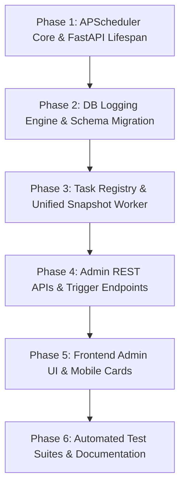

# Functional Requirement Specification: Background Job Scheduler

**Feature ID:** FR17 / NFR14 (FR-Scheduler-APScheduler)  
**GitHub Issue:** [#561](https://github.com/aashishbhanawat/ArthSaarthi/issues/561)  
**Title:** Architectural Background Job Scheduler (APScheduler Integration)  
**Target Release:** v1.5.0  

---

## 1. Sub-component Breakdown & Micro-Phases

To ensure modularity and zero regression across Docker, Desktop (SQLite), and Mobile (Android) environments, this feature is partitioned into 6 distinct micro-phases:



### Phase 1.1: Core APScheduler Singleton & FastAPI Lifespan Hooks
* Integrate pure-Python `apscheduler>=3.10.4,<4.0.0` into `backend/requirements.in`.
* Implement a singleton scheduler manager in `backend/app/core/scheduler.py` wrapping `AsyncIOScheduler`.
* Hook scheduler lifecycle into FastAPI startup and shutdown lifespan handlers in `backend/app/main.py`.

### Phase 1.2: Job Execution Event Listeners & Database Logging Engine
* Create `scheduled_job_logs` table via an Alembic database migration.
* Implement custom APScheduler event listeners for `EVENT_JOB_EXECUTED`, `EVENT_JOB_ERROR`, and `EVENT_JOB_MISSED`.
* Securely record job execution status (`SUCCESS`, `FAILED`, `MISSED`), run duration, and error tracebacks.

### Phase 1.3: Background Task Registry & Initial Unified Snapshot Worker
* Build modular task registry in `backend/app/tasks/` (`registry.py`, `snapshot_task.py`).
* Migrate the legacy, hardcoded `_desktop_snapshot_loop()` in `main.py` into a standardized APScheduler task (`daily_portfolio_snapshot_job`).
* Prepare extensible worker hooks for upcoming Release v1.5.0 features: Automated Corporate Actions (#562) and Market News Feed (#86).

### Phase 1.4: Admin REST APIs & Trigger Endpoints
* Implement secure admin endpoints in `backend/app/api/v1/endpoints/scheduler.py` guarded by `get_current_admin_user`.
* Endpoints for listing registered jobs, manually triggering an immediate asynchronous run, pausing/resuming jobs, viewing execution logs, and pruning old logs.

### Phase 1.5: Frontend Admin UI (`SchedulerDashboard.tsx`) & Mobile Responsive View
* Build a responsive dashboard component in `frontend/src/components/Admin/SchedulerDashboard.tsx`.
* Embed the scheduler dashboard directly into `frontend/src/pages/Admin/SystemMaintenancePage.tsx`.
* Provide responsive design: desktop data table with job actions, collapsing to touch-friendly mobile cards on viewports `< 768px`.
* Add an execution log inspection drawer/modal with formatted error stack traces and manual refresh/polling.

### Phase 1.6: Automated & Manual Verification
* Pytest unit and integration test coverage across PostgreSQL and SQLite (in-memory & file-based).
* Frontend Vitest unit tests for the dashboard UI.
* End-to-end Playwright tests verifying the admin manual trigger flow.

---

## 2. Technical Specification (Backend & Frontend)

### 2.1 Backend Implementation Details

#### 1. Scheduler Core (`backend/app/core/scheduler.py`)
* Wraps `apscheduler.schedulers.asyncio.AsyncIOScheduler`.
* **Execution Options:**
  * `coalesce=True`: Prevents buildup of missed job executions if the server was sleeping or temporarily stalled.
  * `max_instances=1`: Strict concurrency control ensuring that if a job execution exceeds its schedule interval, multiple instances of the same job do not run simultaneously.
  * `misfire_grace_time=300`: Allows executions delayed by up to 5 minutes to proceed.
* **Lifecycle Management:**
  * `start_scheduler()`: Starts the scheduler instance if not already running.
  * `shutdown_scheduler(wait=False)`: Gracefully stops the scheduler on server termination without blocking shutdown.

#### 2. Event Listeners & Audit Trail
* Register listeners on `AsyncIOScheduler`:
  ```python
  scheduler.add_listener(
      job_event_listener,
      EVENT_JOB_EXECUTED | EVENT_JOB_ERROR | EVENT_JOB_MISSED
  )
  ```
* In `job_event_listener(event)`:
  * Open an isolated database session (`SessionLocal()`).
  * Persist a log entry in `scheduled_job_logs` recording:
    * `job_id`: e.g., `daily_portfolio_snapshot`
    * `job_name`: Human-readable name
    * `status`: `SUCCESS` or `FAILED`
    * `started_at` & `finished_at`
    * `execution_time_seconds`: Total run time
    * `error_message`: Sanitized exception traceback if an error occurred.
  * Ensure the DB session is closed in a `finally` block to prevent connection leaks.

#### 2. Concurrency & Overlap Prevention
* In addition to APScheduler's `max_instances=1`, the task registry maintains an in-memory execution lock (`set` of running `job_id`s) to immediately reject manual API trigger requests if a run is already in progress (`409 Conflict: Job is currently executing`).

#### 3. Task Registry (`backend/app/tasks/`)
* **`backend/app/tasks/registry.py`**:
  * Central registry dictionary defining all system background jobs, their schedule triggers (cron/interval), defaults, descriptions, and target coroutines.
* **`backend/app/tasks/snapshot_task.py`**:
  * Encapsulates `take_daily_snapshots_for_all(db)`.
  * Runs on a configurable cron (default: daily at `00:05` local/UTC or every 6 hours depending on deployment mode).

### 2.2 Frontend Implementation Details

* **Component:** `frontend/src/components/Admin/SchedulerDashboard.tsx`
* **Parent Page:** `frontend/src/pages/Admin/SystemMaintenancePage.tsx`
* **Features:**
  * **Summary KPI Cards:**
    * Total Registered Jobs
    * Active / Scheduled Jobs
    * Paused Jobs
    * Failures (Last 24 Hours)
  * **Job List Table (Desktop):**
    * Columns: Job ID, Name, Schedule / Trigger, Next Run Time, Last Status, Actions.
    * Status Pills: Emerald (`IDLE` / `ACTIVE`), Amber (`RUNNING` / `PAUSED`), Rose (`FAILED`).
    * Actions:
      * **"Run Now"** (play icon): Dispatches `POST /api/v1/admin/scheduler/jobs/{job_id}/run` with immediate toast notification and button spinner.
      * **"Pause / Resume"** (pause/play toggle): Dispatches pause/resume requests.
  * **Mobile Card View (`< 768px`):**
    * Collapsible card for each job with prominent status pill, next run time, and full-width "Run Now" button.
  * **Execution History Drawer / Modal:**
    * Displays recent job runs with execution times and duration.
    * For failed runs, provides a collapsible code block displaying the sanitized error traceback.
    * "Clear Logs" action button with confirmation dialog.

---

## 3. Comprehensive Test Plan & Corner Cases

### 3.1 Corner Cases & Failure Scenarios

1. **Job Exception / Crash:**
   * *Scenario:* A background task encounters an unexpected network error or uncaught exception.
   * *Requirement:* The exception must be trapped by the scheduler's event listener, logged to `scheduled_job_logs` with traceback, and must **never** crash the FastAPI server process or abort future scheduled runs.
2. **SQLite Database Concurrency & Lock Contention:**
   * *Scenario:* A background snapshot task writes snapshot rows to SQLite while an active HTTP request is writing transactions.
   * *Requirement:* Database sessions in background tasks must be isolated and short-lived. SQLite WAL (Write-Ahead Logging) mode must remain active, and session commits must complete quickly without prolonged table locks.
3. **Rapid Duplicate Manual Triggers:**
   * *Scenario:* Admin clicks "Run Now" multiple times in quick succession.
   * *Requirement:* The API must return `409 Conflict` ("Job is already running") for concurrent duplicate triggers, preventing duplicate task executions.
4. **Server Teardown / Graceful Shutdown:**
   * *Scenario:* Docker container stops (`SIGTERM`) or desktop app closes while a background task is running.
   * *Requirement:* `shutdown_scheduler(wait=False)` must terminate cleanly within standard timeout windows without hanging the process.
5. **Unauthorized Access:**
   * *Scenario:* A non-admin user attempts to view scheduler status or trigger a job.
   * *Requirement:* The API returns `403 Forbidden` via `get_current_admin_user` dependency.
6. **Timezone & Daylight Savings Changes:**
   * *Scenario:* Server operates across timezone transitions.
   * *Requirement:* APScheduler uses explicit timezone settings (`UTC` or application configured timezone) to prevent missing or duplicated cron jobs.

### 3.2 Manual Testing Checklist

* [ ] **Backend Startup:** Start backend server, verify log message `APScheduler started successfully`.
* [ ] **Admin UI Navigation:** Log in as admin, navigate to Admin -> System Maintenance (`/admin/system-maintenance`).
* [ ] **Verify Job Listing:** Verify `daily_portfolio_snapshot` is listed with valid Next Run timestamp.
* [ ] **Manual Execution Trigger:** Click "Run Now" on `daily_portfolio_snapshot`. Verify button enters loading state, toast displays "Job triggered successfully", and job status shows `RUNNING` followed by `IDLE`.
* [ ] **Verify Execution Log:** Open Execution History drawer; verify the run is recorded with `SUCCESS` status and execution duration.
* [ ] **Duplicate Run Prevention:** Trigger a long-running task twice immediately; verify second request receives a `409 Conflict` notification.
* [ ] **Pause & Resume:** Pause the job; verify UI reflects `PAUSED` state. Resume job; verify next run time is restored.
* [ ] **Mobile Responsiveness:** Open Chrome DevTools in iPhone/Pixel emulation mode; verify job cards format cleanly with full touch targets.
* [ ] **Non-Admin Verification:** Log in as regular user; attempt `GET /api/v1/admin/scheduler/jobs` and verify `403 Forbidden`.

---

## 4. Automated Testing Strategy

### 4.1 Backend Pytest
* **Core Scheduler Unit Tests (`backend/app/tests/core/test_scheduler.py`):**
  * `test_scheduler_startup_and_shutdown`: Verify scheduler starts and shuts down cleanly.
  * `test_scheduler_job_registration`: Verify default tasks are registered with correct triggers.
  * `test_scheduler_event_listener_success`: Mock successful task execution; verify `scheduled_job_logs` record created with `SUCCESS`.
  * `test_scheduler_event_listener_failure`: Mock failing task; verify error is logged to DB without raising exception out of event loop.
* **Scheduler API Tests (`backend/app/tests/api/v1/test_scheduler.py`):**
  * `test_list_jobs_admin_only`: Admin gets 200 with job list; non-admin gets 403.
  * `test_trigger_job_manual`: Verify `POST /api/v1/admin/scheduler/jobs/{id}/run` returns 200 and dispatches task.
  * `test_trigger_running_job_conflict`: Returns 409 when job is already running.
  * `test_pause_and_resume_job`: Verify pause and resume endpoints update job state.
  * `test_get_and_clear_job_logs`: Verify paginated logs retrieval and log clearing endpoint.
* **SQLite Concurrency Test (`backend/app/tests/core/test_scheduler_sqlite.py`):**
  * Verify simultaneous web requests and scheduler DB transactions do not trigger `sqlite3.OperationalError: database is locked`.

### 4.2 Frontend Vitest (`frontend/src/components/Admin/__tests__/SchedulerDashboard.test.tsx`)
* Render component with mocked job list and stats.
* Test "Run Now" button click dispatches correct API call and displays success notification.
* Test Pause/Resume button state toggling.
* Test Log Drawer opening and rendering execution items and stack traces.

### 4.3 E2E Playwright (`e2e/tests/admin-scheduler.spec.ts`)
* Admin logs in, navigates to System Maintenance page.
* Scrolls to "Background Job Scheduler" section.
* Clicks "Run Now" on a job and asserts success toast and log update.

---

## 5. UX & UI Specifications

* **Design Language:** Matches ArthSaarthi design system (Tailwind CSS, dark mode support with `dark:` variants).
* **Location:** Embedded in `SystemMaintenancePage.tsx` alongside `AssetSyncCard` and `CacheDiagnostics`.
* **Visual Elements:**
  * **Status Pills:**
    * `IDLE` / `ACTIVE`: `bg-emerald-100 text-emerald-800 dark:bg-emerald-900/30 dark:text-emerald-400`
    * `RUNNING`: `bg-amber-100 text-amber-800 dark:bg-amber-900/30 dark:text-amber-400 animate-pulse`
    * `PAUSED`: `bg-slate-100 text-slate-800 dark:bg-slate-800 dark:text-slate-400`
    * `FAILED`: `bg-rose-100 text-rose-800 dark:bg-rose-900/30 dark:text-rose-400`
  * **Action Buttons:** Standard icon buttons with tooltips ("Run Now", "Pause", "View Logs").
  * **Log Modal / Drawer:** Dark terminal-style code container (`bg-gray-900 text-gray-100 font-mono text-xs`) for stack trace inspection.

---

## 6. Database Schema & Data Security

### 6.1 Database Schema (`scheduled_job_logs`)

```sql
CREATE TABLE scheduled_job_logs (
    id VARCHAR(36) PRIMARY KEY,
    job_id VARCHAR(100) NOT NULL,
    job_name VARCHAR(255) NOT NULL,
    status VARCHAR(20) NOT NULL, -- SUCCESS, FAILED, MISSED
    started_at TIMESTAMP WITH TIME ZONE NOT NULL,
    finished_at TIMESTAMP WITH TIME ZONE,
    execution_time_seconds FLOAT,
    error_message TEXT,
    created_at TIMESTAMP WITH TIME ZONE DEFAULT CURRENT_TIMESTAMP
);

CREATE INDEX idx_scheduled_job_logs_job_id ON scheduled_job_logs(job_id);
CREATE INDEX idx_scheduled_job_logs_created_at ON scheduled_job_logs(created_at);
```

### 6.2 SQLite Security & Column Encryption Assessment
* **Data Sensitivity Review:** The `scheduled_job_logs` table stores only system-level orchestration metadata (job IDs, run timestamps, execution duration, and sanitized error traces).
* **PII & Financial Data:** No financial assets, user holdings, bank credentials, API secrets, or personally identifiable information (PII) are stored in this table.
* **Error Sanitization:** The error logger applies sanitization to strip potential query parameters, connection strings, or authorization headers from stack traces before saving to `error_message`.
* **Encryption Conclusion:** Column-level AES encryption (`EncryptedString`) is **NOT required** for `scheduled_job_logs`.

---

## 7. Required Documentation Updates

1. **`README.md`:** Add "Background Task Automation" subsection detailing the APScheduler engine, cron triggers, and how asynchronous tasks run in Docker vs Desktop.
2. **`docs/code_flow_guide.md` & `docs/architecture.md`:** Document the `AsyncIOScheduler` singleton lifecycle, how event listeners write to `scheduled_job_logs`, and the standard pattern for registering new tasks in `backend/app/tasks/`.
3. **`docs/workflow_history.md`:** Log the complete implementation details, PR references, and test verification output for Issue #561.
4. **`docs/debugging_guide.md`:** Add a troubleshooting guide for debugging background job failures, inspecting `scheduled_job_logs`, and dealing with SQLite concurrency.
5. **`docs/project_handoff_summary.md`:** Update Section 1 ("Current Project Status") and Section 2 ("Test Suite Status") with completion notes for Issue #561.
6. **`docs/requirements.md`:** Update requirement status for Background Job Scheduler (`FR17 / NFR14`) from Planned to `✅ Done`.

---

## 8. External Data Sources & API Specifications

* **Core Scheduler:** The scheduler itself does not require any external 3rd-party data APIs. It operates strictly within the application process.
* **Orchestrated Workers:** Future workers scheduled by this engine (e.g., Market News Feed #86 and Corporate Actions #562) will use their respective providers (e.g., RSS feeds, NSE). The scheduler provides the execution substrate for those tasks.

---

## 9. File & API Endpoint Inventory

### 9.1 Files to Create & Modify

| Operation | Path | Description |
| :--- | :--- | :--- |
| **Modify** | `backend/requirements.in` | Add `apscheduler>=3.10.4,<4.0.0` dependency |
| **Create** | `backend/app/core/scheduler.py` | Singleton `AsyncIOScheduler` wrapper, lifecycle methods, and event listeners |
| **Create** | `backend/app/models/scheduled_job_log.py` | SQLAlchemy model for `scheduled_job_logs` |
| **Create** | `backend/alembic/versions/k11d3e4f5g6h_add_scheduled_job_logs_table.py` | Alembic migration for new table and indexes |
| **Create** | `backend/app/schemas/scheduler.py` | Pydantic schemas for job metadata, log summaries, and trigger responses |
| **Create** | `backend/app/crud/crud_scheduled_job.py` | CRUD operations for persisting and fetching job execution logs |
| **Create** | `backend/app/tasks/__init__.py` | Package initialization for background workers |
| **Create** | `backend/app/tasks/registry.py` | Task registry and executor functions |
| **Create** | `backend/app/tasks/snapshot_task.py` | Unified daily snapshot background job |
| **Create** | `backend/app/api/v1/endpoints/scheduler.py` | FastAPI admin router for scheduler operations |
| **Modify** | `backend/app/api/v1/api.py` | Mount `/api/v1/admin/scheduler` router |
| **Modify** | `backend/app/main.py` | Integrate scheduler startup/shutdown in FastAPI lifespan; retire legacy loop |
| **Create** | `frontend/src/types/scheduler.ts` | TypeScript interfaces for scheduler jobs and logs |
| **Create** | `frontend/src/services/schedulerService.ts` | Axios client for scheduler admin endpoints |
| **Create** | `frontend/src/components/Admin/SchedulerDashboard.tsx` | UI component with metrics, job table, mobile cards, and log drawer |
| **Modify** | `frontend/src/pages/Admin/SystemMaintenancePage.tsx` | Embed `SchedulerDashboard` card |
| **Create** | `backend/app/tests/core/test_scheduler.py` | Unit tests for scheduler core and event listeners |
| **Create** | `backend/app/tests/api/v1/test_scheduler.py` | API endpoint integration tests |
| **Create** | `frontend/src/components/Admin/__tests__/SchedulerDashboard.test.tsx` | Frontend Vitest component tests |

### 9.2 API Route Specifications

| Method | Endpoint | Authorization | Description |
| :--- | :--- | :--- | :--- |
| `GET` | `/api/v1/admin/scheduler/jobs` | Admin Only | List all registered jobs, triggers, next run times, and statuses |
| `POST` | `/api/v1/admin/scheduler/jobs/{job_id}/run` | Admin Only | Trigger an asynchronous job execution immediately |
| `POST` | `/api/v1/admin/scheduler/jobs/{job_id}/pause` | Admin Only | Pause scheduled execution of a job |
| `POST` | `/api/v1/admin/scheduler/jobs/{job_id}/resume` | Admin Only | Resume scheduled execution of a paused job |
| `GET` | `/api/v1/admin/scheduler/logs` | Admin Only | Get paginated execution history logs (with optional `job_id` and `status` filters) |
| `DELETE` | `/api/v1/admin/scheduler/logs` | Admin Only | Prune job execution logs older than specified retention days (default 30 days) |

---

## 10. Mobile-Friendly UI & Responsive Design

* **Breakpoint Strategy:**
  * **Desktop / Tablet (`>= 768px`):** Full-width data table showing Job ID, Name, Trigger Cron, Next Run Time, Status, and Action buttons.
  * **Mobile (`< 768px`):** Table hides and transforms into stacked cards. Each card displays:
    * Job Name & ID
    * Status pill prominently positioned at top-right
    * Next scheduled run time
    * Full-width "Run Now" action button with touch target `>= 44px` height
* **Execution Log Viewer:**
  * Uses a slide-over drawer on desktop, and a full-screen scrollable bottom sheet / modal on mobile devices.

---

## 11. Android Compatibility & Python Library Constraints

* **Pure-Python Validation:**
  * `apscheduler` version 3.10.x is written in **100% pure Python**.
  * It has **no C-extensions, Cython modules, or native shared libraries (`.so`)**.
  * It compiles and runs cleanly inside embedded Android Python environments (Chaquopy / Kivy / Termux) and PyInstaller desktop binaries.
* **Coexistence with Android Native WorkManager:**
  * On mobile builds, the Android native `SnapshotWorker.kt` (WorkManager) triggers background snapshots even when the app is suspended.
  * When the ArthSaarthi Python backend is running (app in foreground or service mode), APScheduler handles in-process scheduled tasks seamlessly.
  * The snapshot service already implements idempotent checks (`take_daily_snapshots_for_all`) so multiple triggers on the same calendar day safely no-op without duplicating records.
